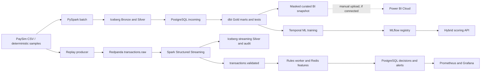

# Implemented architecture and boundaries

## What is implemented

- Batch and streaming use separate Iceberg tables. Airflow orchestrates finite batch and model-candidate tasks; it does not orchestrate the continuously running Spark stream.
- The streaming worker publishes validated events to the rules worker. The hybrid API is a separate scoring path; **the rules worker does not call it for each Kafka event**.
- Redpanda publication is at-least-once. The Iceberg Silver merge is idempotent by transaction ID, but the platform does not claim end-to-end exactly-once decisions.
- PostgreSQL/dbt Gold covers the batch sample; decisions and alerts are a distinct population. Their denominators must not be mixed in BI.
- A masked BI workbook and local validation exist. No Power BI Cloud report/PDF export is proven in this repository until a real cloud artifact is added. The dotted arrow is a manual optional publication step, not a live data feed.
- PaySim event time is simulated. Replay processing delay is not production fraud-decision latency.

## Local limits and cloud direction

The development host is an Apple M3 with 8 GiB RAM and an approximately 3.83 GiB Docker VM. Spark, ML training, API load tests, and Grafana rendering run in separate phases. The broker has one partition and one replica. A cloud implementation would use multiple partitions/replicas, managed object storage and catalog, separate model serving, autoscaling consumers, secrets management, and a supported BI refresh path. These are design directions, not features of this local release.

See [performance evidence](../reports/week10/performance.md), [streaming semantics](streaming-semantics.md), [BI status](power-bi-cloud-plan.md), and [runbook](runbook.md).
