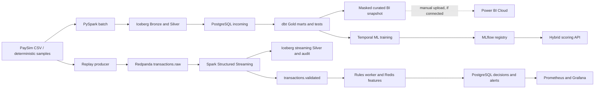

# Implemented architecture and boundaries

## What is implemented

- Batch and streaming use separate Iceberg tables. Airflow orchestrates finite batch and model-candidate tasks; it does not orchestrate the continuously running Spark stream.
- The streaming worker publishes validated events to the rules worker. The hybrid API is a separate scoring path; **the rules worker does not call it for each Kafka event**.
- Redpanda publication is at-least-once. The Iceberg Silver merge is idempotent by transaction ID, but the platform does not claim end-to-end exactly-once decisions.
- PostgreSQL/dbt Gold covers the batch sample; decisions and alerts are a distinct population. Their denominators must not be mixed in BI.
- A masked BI workbook and local validation exist. No Power BI Cloud report/PDF export is proven in this repository until a real cloud artifact is added. The dotted arrow is a manual optional publication step, not a live data feed.
- PaySim event time is simulated. Replay processing delay is not production fraud-decision latency.

## Local limits and cloud direction

The development host is an Apple M3 with 8 GiB RAM and an approximately 3.83 GiB Docker VM. Spark, ML training, API load tests, and Grafana rendering run in separate phases. The broker has one partition and one replica. A cloud implementation would use multiple partitions/replicas, managed object storage and catalog, separate model serving, autoscaling consumers, secrets management, and a supported BI refresh path. These are design directions, not features of this local release.

## Architecture decisions (accepted for the local portfolio build)

| Decision | Why this choice | Alternative and consequence |
|---|---|---|
| PySpark for batch and event-time streaming | Shared transaction schema, Iceberg writes, Kafka input and restartable checkpoints; local mode uses two cores. | DuckDB plus a Python consumer would be lighter but would not demonstrate the same distributed-processing path. Flink adds another runtime. Spark's JVM startup, memory use and micro-batch delay are substantial on 8 GiB RAM. |
| One Redpanda broker with Kafka-compatible topics | Durable log, replay, offsets and consumer groups without a multi-service Kafka stack. | Apache Kafka is representative but heavier locally; an in-process queue would hide offset and lag semantics. One broker/partition/replica has no high availability. |
| Iceberg Bronze/Silver on local filesystem | Table metadata and transaction-ID merges support reproducible batch backfill and stream retry. | Plain Parquet needs custom table commit/deduplication; Delta Lake is another valid format. Iceberg adds metadata/small-file and Spark memory costs. Kafka output remains at-least-once. |
| Hard rules plus a version-pinned model in the separate API | Explainable hard-rule precedence and explicit rule-only fallback on model failure, timeout or saturation. | Model-only serving lacks deterministic fallback; rules-only would omit ML lifecycle. The in-process timeout cannot kill a stuck thread; production needs process isolation or remote serving with circuit breaking. |

The original Week 1 diagram in the project plan was a **target**, not an implementation claim. In particular, the planned direct streaming-rules-to-model path and Power BI Cloud publication have not been implemented. Thresholds and throughput goals in the [roadmap](../ROADMAP.md) were hypotheses; measured results and their limits are in the [performance report](../reports/week10/performance.md).

See [performance evidence](../reports/week10/performance.md), [streaming semantics](streaming-semantics.md), [BI status](power-bi-cloud-plan.md), and [runbook](runbook.md).
