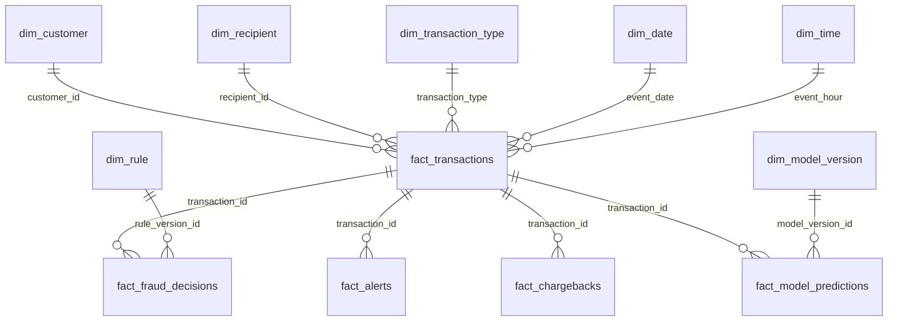

# Tuần 3 — PostgreSQL warehouse và dbt semantic layer

## Phạm vi và cách chạy lại

Mốc đo: 2026-10-14, MacBook Pro M3 8 GB; PostgreSQL 16 (`mem_limit: 384m`), dbt Core 1.10.13 / dbt-postgres 1.10.0 (`mem_limit: 768m`), 2 dbt threads. Đầu vào là Iceberg `lake.silver.transactions_valid` trong `data/tmp/week2-benchmark-100k-v1` của Tuần 2. Đường đi:

```text
Iceberg Silver 100k ──Spark JDBC──> warehouse_raw.transactions_silver_incoming
                                     │ INSERT ... ON CONFLICT DO NOTHING
                                     v
                           warehouse_raw.transactions_silver
                                     │ dbt source()
                                     v
                           analytics_staging.stg_transactions
                                     │ dbt ref()
                     ┌───────────────┴─────────────────┐
                     v                                 v
        analytics_intermediate.int_transactions_enriched  five dimensions
                     │
                     v
             analytics_marts.fact_transactions
```

Chạy từ project root (sau khi Tuần 2 đã tạo warehouse 100k):

```bash
make warehouse-up
docker compose --profile warehouse build dbt
make spark-build                      # chỉ cần khi image Spark chưa có JDBC JAR
make warehouse-export-100k
make warehouse-merge
make dbt-build
make dbt-docs
```

`make warehouse-export-100k` chỉ giữ Spark trong một job; `make dbt-build` chạy khi Spark đã dừng. `.env` chứa `POSTGRES_PASSWORD` local và không được commit. Sau khi xong có thể dừng PostgreSQL bằng `docker compose --profile warehouse stop postgres`; named volume được giữ. Nếu đổi logic window hoặc nhận backfill làm thay đổi lịch sử customer cũ, dùng `make dbt-build DBT_FLAGS=--full-refresh` để tính lại toàn bộ fact và tự áp lại index.

## Grain, khóa và star schema

`fact_transactions`: đúng **một dòng trên `transaction_id`**. ID là content-based SHA-256 của pipeline Tuần 2, không phải ID do PaySim phát hành. Các dimensions dùng natural key từ dữ liệu mẫu; vì PaySim gần như mỗi tài khoản gửi chỉ xuất hiện một lần, `dim_customer` có cardinality cao và chưa đem lại mức nén mạnh. Đây là lựa chọn minh bạch cho portfolio; hệ thống thật có thể dùng surrogate key và SCD khi master data thay đổi.

| Bảng thực tế | Grain / khóa | Ghi chú |
|---|---|---|
| `fact_transactions` | 1 `transaction_id` | `amount`, `event_time`, label offline, balance flags, window aggregates |
| `dim_customer` | 1 `customer_id` / `nameOrig` | first/last seen, transaction count |
| `dim_recipient` | 1 `recipient_id` / `nameDest` | first/last seen, received count |
| `dim_transaction_type` | 1 mã type | 5 mã PaySim hợp lệ |
| `dim_date` | 1 `event_date` UTC | year/month/day |
| `dim_time` | 1 `event_hour` UTC | 0–23, day part |



**Chỉ năm dimensions và `fact_transactions` đang tồn tại.** Các hộp sau đây là *future contracts*, chưa tạo fact có dòng giả:

| Contract tương lai | Grain dự kiến | Khóa liên kết / trường cốt lõi |
|---|---|---|
| `fact_fraud_decisions` | 1 `decision_id` cho mỗi lần ra quyết định | `transaction_id`, `rule_version_id` nullable, outcome, reason code, `decided_at` |
| `fact_alerts` | 1 `alert_id` | `transaction_id`, status, created/closed time |
| `fact_chargebacks` | 1 `chargeback_case_id` | `transaction_id`, dispute date, amount, status |
| `fact_model_predictions` | 1 `prediction_id` / lần scoring | `transaction_id`, `model_version_id`, score, `scored_at` |
| `dim_rule` | 1 `rule_version_id` | rule name/version, effective interval |
| `dim_model_version` | 1 `model_version_id` | artifact URI, training/evaluation metadata |

Các nguồn decision/alert/model/chargeback chỉ xuất hiện từ Tuần 4 trở đi. `isFraud` của PaySim là ground truth cho **hậu kiểm**, không phải chargeback thật hay đầu vào scoring. `isFlaggedFraud` cũng không được dùng làm feature để dự đoán ground truth. `event_time` là thời gian mô phỏng từ `step`, không phải timestamp lịch sử ngoài đời.

## Tính đúng đắn và incremental

- Spark chỉ `overwrite` bảng chuyển tiếp `transactions_silver_incoming`. Bảng raw bền vững dùng `INSERT ... ON CONFLICT (transaction_id) DO NOTHING`; retry cùng batch không nhân đôi.
- dbt `fact_transactions` dùng incremental `delete+insert`, `unique_key=transaction_id`, và chỉ chọn ID chưa có. Điều này đúng với hợp đồng Silver **insert-only** hiện tại, kể cả event date cũ được nạp muộn.
- `int_transactions_enriched` dùng `lag`, rolling 5 events và cửa sổ 24 giờ. Cửa sổ `RANGE` 24h bao gồm các giao dịch cùng `event_time` mô phỏng, nên **không point-in-time-safe cho online scoring/ML**. Nó chỉ dành cho batch analytics; feature ML ở tuần sau phải có cutoff theo thời điểm dự đoán và backtest theo thời gian.
- Index được version-control trong `sql/warehouse/003_indexes.sql`. `make dbt-build` chạy migration này sau dbt vì `--full-refresh` thay bảng fact và làm mất index tạo thủ công. Chạy trần `dbt build --full-refresh` thì cần `make warehouse-indexes` sau đó.
- PostgreSQL local không được expose ra Internet để phục vụ Power BI Cloud. BI sau này nhận curated/masked snapshot theo `docs/power-bi-cloud-plan.md`.

## Kết quả đối soát trên mẫu 100k

| Kiểm tra | Kết quả |
|---|---:|
| `warehouse_raw.transactions_silver` | 100.000 |
| `analytics_marts.fact_transactions` sau full-refresh **và** lượt incremental retry | 100.000 |
| `dim_customer` / `dim_recipient` | 99.998 / 92.861 |
| `dim_transaction_type` / `dim_date` / `dim_time` | 5 / 31 / 24 |
| Fraud ground-truth | 137 |
| Tổng amount raw = fact | 17.550.906.025,15 |
| dbt models / data tests | 8 / 28 |
| `dbt build` cuối | PASS=36, WARN=0, ERROR=0 |
| Orphan customer, recipient, type, date, time | 0 (5 `relationships` tests pass) |

dbt còn kiểm tra unique, not-null, accepted values, count và tổng amount/fraud raw ↔ fact, cùng bounds của rolling/velocity. Generated docs và lineage nằm ở `dbt/target/` (không commit); tạo lại bằng `make dbt-docs`.

## Hai trường hợp query tuning

Đo bằng `EXPLAIN (ANALYZE, BUFFERS)` trên cùng fact 100k, trước khi tạo index và sau khi chạy `sql/warehouse/003_indexes.sql`. Đây là **một lần đo local**, không phải SLA; cache, worker và hoạt động máy làm thời gian dao động. Dùng plan và buffers để giải thích thay vì chỉ so hai con số ms.

### Case A — 20 fraud transactions mới nhất (offline operations)

```sql
EXPLAIN (ANALYZE, BUFFERS)
SELECT transaction_id, event_time, amount
FROM analytics_marts.fact_transactions
WHERE is_fraud_actual = 1
ORDER BY event_time DESC
LIMIT 20;
```

| Trước index | Sau partial index `idx_fact_fraud_recent` |
|---|---|
| `Seq Scan` + `Sort`, 99.863 rows removed | `Index Scan`, không cần Sort riêng |
| shared hit/read = 1.855 / 2.052 | shared hit/read = 9 / 12 |
| Execution Time = **25,046 ms** | Execution Time = **11,046 ms** |

Index partial chỉ chứa giao dịch có `is_fraud_actual=1`, sắp theo `event_time DESC`. Đây là truy vấn **hậu kiểm**, không phải cách ra quyết định realtime.

### Case B — 20 giao dịch mới nhất của một customer

Customer được chọn: `C1076816046`, có 2 giao dịch trong sample.

```sql
EXPLAIN (ANALYZE, BUFFERS)
SELECT transaction_id, event_time, amount
FROM analytics_marts.fact_transactions
WHERE customer_id = 'C1076816046'
ORDER BY event_time DESC
LIMIT 20;
```

| Trước index | Sau index `idx_fact_customer_time` |
|---|---|
| `Seq Scan` + `Sort`, 99.998 rows removed | `Index Scan` với `Index Cond` trên customer_id |
| shared hit/read = 1.887 / 2.020 | shared hit/read = 0 / 4 |
| Execution Time = **17,359 ms** | Execution Time = **0,845 ms** |

Index bắt đầu bằng `customer_id` nên PostgreSQL định vị hai dòng cần đọc, thay vì duyệt toàn fact.

Query dashboard `GROUP BY event_date, transaction_type` (count, fraud count, amount) trả 151 nhóm; `EXPLAIN ANALYZE` đo **193,514 ms** ở lần chạy có đọc đĩa. Với mẫu 100k đây là thời gian local phù hợp để kiểm chứng dashboard. Khi tải dữ liệu lớn hoặc đưa lên Power BI Cloud, tạo aggregate mart/snapshot riêng thay vì cho dashboard quét toàn fact mỗi lần.

## Hạn chế còn chủ ý

Chưa có decision, alert, chargeback, prediction fact hoặc dimension rule/model-version thật; đó là phạm vi các tuần streaming/rules/ML tiếp theo. Chưa có Power BI Cloud report hay real-time warehouse ingest ở Tuần 3. Kết quả trên sample 100k không được suy rộng thành hiệu năng trên toàn bộ 6,36 triệu giao dịch.
